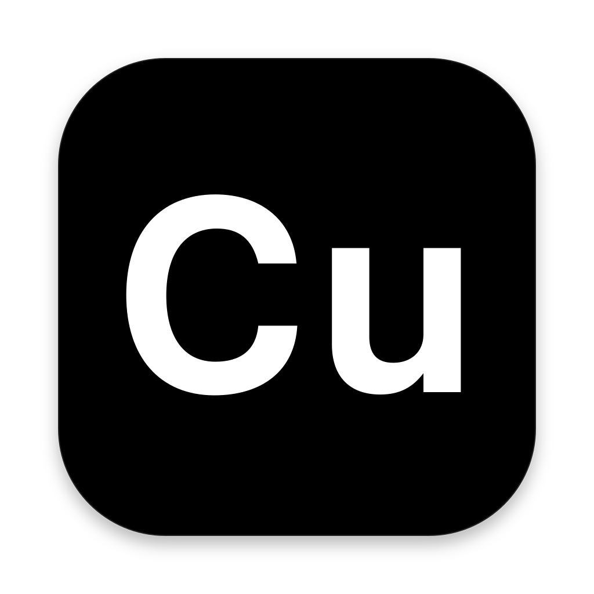

# prj23 · Cumulus（Cu）



Colab 上 ComfyUI 的 macOS 原生客户端（Rust + GPUI）。一键在 Google Colab 开 GPU、挂载 Google Drive 里的模型、安装并启动 ComfyUI，转发到本机浏览器使用；显示 CU 余额和消耗，闲置自动关机，出图自动同步回本机，可以直接往 Drive 下载模型。

## 运行

**直接下载**：在 [Releases](https://github.com/wangyuzhao0118-sketch/cumulus/releases) 下载 `Cumulus-<版本>-macos-arm64.zip`（Apple Silicon，macOS 11+），解压后把 Cumulus.app 拖进「应用程序」。应用没有经过 Apple 公证，第一次打开会被拦下，先运行：

```bash
xattr -dr com.apple.quarantine /Applications/Cumulus.app
```

**自己编译**：

```bash
./bundle.sh                 # 编译并生成 target/Cumulus.app
open target/Cumulus.app
# 开发时：cargo run [-- --page home|models|outputs|logs|settings]
```

前提：装好官方 [colab CLI](https://github.com/googlecolab/google-colab-cli) 并登录一次：

```bash
uv tool install google-colab-cli
colab sessions          # 第一次会打开浏览器登录 Google
```

## 命令行（方便脚本和 AI 助手操作）

程序本身就是命令行工具：带命令运行时不开窗口。装到 PATH 里：

```bash
ln -sf "$PWD/target/Cumulus.app/Contents/MacOS/cumulus" ~/.local/bin/cumulus
cumulus help
```

```bash
cumulus up --gpu L4                 # 开机并启动 ComfyUI，等到就绪（打印 ComfyUI 地址）
cumulus status                      # 阶段、GPU、CU 余额、自动关机倒计时
cumulus run flux_api.json           # 提交 API 格式工作流（先把用到的模型复制到 SSD），等跑完并同步回本机，打印本机文件路径
cumulus models                      # Drive 上的模型（标出哪些在本地 SSD）
cumulus download loras <地址>        # 在 VM 上下载模型到 Drive
cumulus ssd add checkpoints/x.safetensors   # 复制到 VM 本地 SSD
cumulus ssd from flux_api.json      # 工作流用到的模型全部复制到 SSD（--dry-run 只看）
cumulus workflows                   # ComfyUI 里保存的工作流（ssd from 也可以直接写它们的名字）
cumulus ssd profile save 视频 --from wan_t2v   # 把一个工作流用到的模型存成 SSD 方案
cumulus ssd profile use 视频         # 整组换上：SSD 上只留方案里的模型
cumulus exec nvidia-smi             # 在 VM 上执行命令（复用已有连接）
cumulus config set idle_min 20      # 修改设置
cumulus down                        # 同步出图后关机
```

- **同一个引擎**：命令行不自己连 VM（Colab 每台 VM 只允许一条 ssh 连接），而是通过本机 unix socket（`~/Library/Application Support/cumulus/control.sock`）把命令交给掌管 VM 的进程：开着窗口时就是窗口里的程序，界面会同步显示命令行做的事；没开窗口时自动起一个无界面的守护进程（`cumulus --guard`），由它负责自动关机和出图同步，VM 关着且 2 分钟没有命令就退出。之后打开窗口会自动接管。
- **给 AI 用**：每个命令都可以加 `--json`，stdout 只输出一个 JSON 对象（出错时 `{"ok": false, "error": "…"}`）；等待过程中的日志和进度写到 stderr（不是终端时每 15 秒一行，免得刷屏）。退出码 0 成功、1 失败（`exec` 原样返回 VM 上命令的退出码）。`up` / `down` / `run` / `download` / `ssd add` 默认等到完成，`--no-wait` 立即返回。
- **需要人做的一步**：新 VM 挂 Drive 要在浏览器里点「允许」。`up` 会打印授权地址并等待；授权后在终端按回车，或运行 `cumulus drive-continue`。
- **危险操作**要显式确认：`rm-model` 必须加 `--yes`。令牌（`hf_token` 等）可以用 `config set` 设置，但 `config` 不会把它们显示出来。
- **给 AI 的使用说明**：`skills/cumulus/SKILL.md` 是一个 Claude Code Skill，写了什么时候用哪个命令、开机花钱要记得关、Drive 授权要用户自己点、删除前要问。装上后 AI 助手会自动按它操作：

  ```bash
  mkdir -p ~/.claude/skills && ln -sf "$PWD/skills/cumulus" ~/.claude/skills/cumulus
  ```
- `CUMULUS_CONFIG_DIR=<目录>` 可以用另一套设置（会话名不同就是另一台 VM），测试时不会碰到正在用的 VM。

## 工作方式

- **不需要 Cloudflare / ngrok / 公网服务器**。`colab ssh --proxy-mode` 走 Colab 自己的 WebSocket 通道，当作 OpenSSH 的 ProxyCommand。客户端建一条 ssh 主连接（ControlMaster），在上面做 `-L 127.0.0.1:8188 → VM:8188` 端口转发，之后状态查询、出图同步、模型下载都复用这条连接。ssh 用专用密钥 `~/Library/Application Support/cumulus/id_ed25519`（自动生成）。
- **开机流程**：`colab new --gpu X` → ssh 连接 → `colab drivemount`（每台新 VM 都要在浏览器里授权一次，界面上有按钮）→ 在 VM 上执行 `kit/boot.sh`：克隆 ComfyUI、装依赖和自定义节点、生成 `extra_model_paths.yaml` → 启动 ComfyUI（只监听 VM 的 127.0.0.1）。开机进度按步骤显示，完整输出在「日志」页。
- **Drive 目录约定**（默认 `/content/drive/MyDrive/AI_Models/ComfyUI_L4`，可在设置里改）：
  - `models/<类别>/`：`models/` 下每个子文件夹都自动映射成同名模型类别（`checkpoints`、`diffusion_models`、`loras`、`vae`、`text_encoders`……），模型直接从 Drive 读取，不用复制；
  - `workflows/`：ComfyUI 的工作流保存目录链接到这里，下次开机还在；
  - `input/`：上传的参考图；
  - `output/`：打开「出图也存 Drive」时出图写到这里。
- **重新接上**：打开程序时如果 Colab 上已经有同名会话（默认 `cumulus`）在跑，自动重新连接，不会再开一台。
- **CU 与自动关机**：每分钟读取 `colab usage` 显示余额和每小时消耗，估算本次花费。满足任一条件自动关机：闲置超过 N 分钟（没有排队任务且 GPU 利用率低于 20%）、单次开机超过 N 小时、余额低于设定值。剩 2 分钟时提示，可以点「延长」重新计时。每 10 分钟在内核里执行一次心跳，避免 Colab 把会话当成闲置回收。
- **退出程序**：VM 在跑时会询问「关机并退出」还是「保持运行并退出」。保持运行时留下一个无界面的守护进程（`cumulus --guard`，日志在 `~/Library/Application Support/cumulus/guard.log`），继续负责自动关机和出图同步；再次打开程序时它会自动退出，由程序接管。
- **出图同步**：每 4 秒检查 VM 上的出图目录，把本次开机后新生成的图片 / 视频 / 音频拉回本机 `~/Pictures/Cumulus/<开机日期时间>/`。「出图」页是缩略图网格，点击用默认程序打开，⌘+点击在 Finder 中显示。关机前会先把没同步的文件拉完。
- **模型下载**：粘贴 Hugging Face / Civitai / 任意直链，选类别，在 VM 上直接下载到 Drive 的 `models/<类别>/`（Colab 机房带宽），显示进度和速度，可以取消，再次下载同一地址会断点续传。需要授权的模型在设置里填 HF / Civitai 令牌。「已有模型」按类别列出 Drive 里的模型和大小，可以删除（进 Drive 回收站）。
- **本地 SSD 加速**：Colab 的 Drive 挂载（DriveFS）每个文件只走一条连接，没缓存过的文件只有约 35–50 MB/s；它自带的本地缓存约 64 GB，满了会淘汰旧文件。「模型」页每个模型后面有「SSD」开关，打开后在 VM 上把它复制到本地 SSD `/content/cumulus_ssd/models/<类别>/`：直接调 Drive API，对一个文件开 16 条连接、按 128 MB 分块下载（L4 实测约 300 MB/s，是挂载目录的 6–8 倍），访问令牌用 DriveFS 自己用的那个（Colab VM 元数据服务提供，只在 VM 上用）；拿不到令牌或找不到文件时自动退回从挂载目录顺序复制。同时复制 2 个文件，可以取消，中断后按块接着下载。`extra_model_paths.yaml` 里本地 SSD 排在 Drive 前面，同名模型 ComfyUI 优先从 SSD 读，没复制的照旧从 Drive 读，工作流不用改。选择会保存在设置里，开机后自动重新复制（可关）；关机后 SSD 上的副本随 VM 消失，Drive 原文件不受影响。重新接上旧版本启动的 VM 时，如果配置里还没有 SSD 目录且没有任务在跑，会自动重启 ComfyUI 换上新配置。
- **按工作流导入 SSD**：「本地 SSD 加速」卡片上点「从工作流导入…」，选 ComfyUI 里保存的工作流（接了 Drive 就在 Drive 的 `workflows/` 下）或本机的 .json 文件，列出它用到的模型：哪些已在 SSD、哪些要复制、Drive 上缺哪些，点一下全部复制（先检查 SSD 空间）。界面格式（包括子图）和 API 格式都支持：整个工作流里找模型文件名（.safetensors / .gguf / .ckpt / .pt / .pth 等），先按完整名字、再按文件名和 Drive 上的模型对上；同名文件在几个类别里都有时，按官方模板里标注的类别选。模板里带下载地址的缺失模型可以直接点「下载」到对应类别。命令行是 `cumulus ssd from <工作流>`。
- **SSD 方案和容量**：把一组模型存成方案（按工作流分，比如「Qwen 出图」「视频」），点一下整组换上：SSD 上只留方案里的模型，别的删掉腾地方（开着时会先确认），缺的开始复制。可以把当前选择存成方案，也可以在「从工作流导入」里把工作流用到的模型存成方案。每种 GPU 的 VM 上能放多少模型，开机时量出来记在设置里（`ssd_room`），模型大小也记在本机（`models_cache`），所以关机时也能看到「已选 28.5 GB / SSD 可放约 37 GB」、方案放不放得下；放不下会标黄，开着时切换会直接拒绝。
- **运行时自动复制**（默认开）：ComfyUI 开始跑一个工作流时（不管是在浏览器里点的还是命令行提交的），把它用到、还不在 SSD 上的模型复制过去，这次照旧从 Drive 读，下次加载就快了；SSD 放不下就提示，不复制。`cumulus run` 更进一步：提交前先复制完再跑（`--no-ssd` 跳过）。
- **从旧名字 Nimbus 升级**：第一次打开时把 `~/Library/Application Support/nimbus/` 整个搬到 `cumulus/`（设置、ssh 密钥都保留）；旧设置没写会话名的沿用旧的 `nimbus`，所以能直接接上正在跑的 VM；旧程序留下的 ssh 连接会被清掉。
- **设置**保存在 `~/Library/Application Support/cumulus/config`（权限 600，里面有令牌）。

## 目录

- `src/engine.rs`：开机 / 关机状态机、监控、自动关机、出图同步、模型下载（后台线程，界面只读共享状态）
- `src/remote.rs`：colab CLI 和 ssh 的封装与输出解析
- `src/config.rs`：设置
- `src/main.rs`：界面（控制台、模型、出图、日志、设置）、守护模式、自测
- `src/cli.rs`、`src/control.rs`：命令行，以及掌管进程上的本机控制接口
- `src/workflow.rs`：从工作流里找出用到的模型，和 Drive 上的模型对上
- `skills/cumulus/SKILL.md`：给 AI 助手（Claude Code）的使用说明
- `kit/boot.sh`、`kit/poll.py`、`kit/dl.py`、`kit/cp.py`：在 VM 上执行的脚本（编译时打进程序，每次通过 ssh 送过去）
- `src/theme.rs`、`src/anim.rs`、`src/input.rs`：沿用 prj22（Lithium）的主题、动画和输入框
- `assets/cu.svg` → `tools/make-icon.sh assets/cu.svg` 生成 `assets/AppIcon.icns`（和 Lithium 同一套黑底粗体图标，缩写 Cu = 铜）

## 测试

- `cargo test`：解析逻辑和设置的单元测试。
- `cumulus --selftest [--keep]`：不开窗口真跑一遍：开机（或接上已有会话）→ 挂 Drive → 启动 ComfyUI → 经本机端口转发提交一个不需要模型的小任务（EmptyImage → SaveImage）→ 确认出图同步回本机 → 列出 Drive 模型 → 下载一个小文件、复制到本地 SSD、再删除 → 关机（`--keep` 则保持运行）。会消耗少量 CU。

## 许可

MIT，见 [LICENSE](LICENSE)。

本项目与 Google、Comfy Org 无关；需要你自己的 Google 账号和 Colab 计算单元（CU）。
